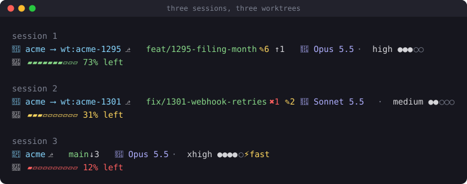
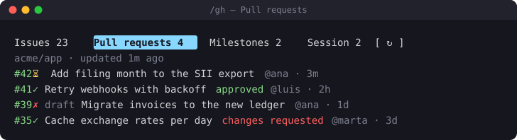
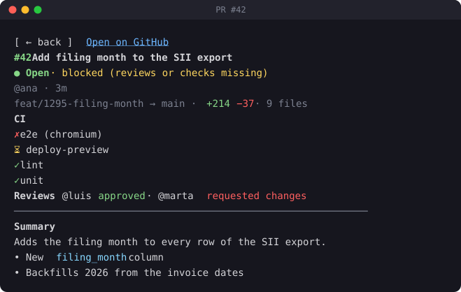

# tokephobia

**A status line and GitHub plugin for [Claude Code](https://code.claude.com), built for running several sessions in parallel, each in its own worktree.**


- **Know where each session is working.** tokephobia shows the worktree and branch the session actually works in, not the folder it was launched from.
- **Watch the budget.** It shows context left, plan usage and when it resets, and the model with its reasoning effort.
- **Keep GitHub one key away.** The repo's issues, PRs and milestones, and the PRs this session opened, sit above the prompt. Press one to see its CI, reviews and description without leaving the terminal.

## Quickstart

### Let Claude install it

Paste this into Claude Code:

```text
Install tokephobia: clone https://github.com/albertomarturelo/tokephobia
and follow its INSTALL.md step by step.
```

[INSTALL.md](INSTALL.md) is written for agents. It checks the requirements, installs, verifies the result and tells you what changed.

### Or by hand

```sh
git clone https://github.com/albertomarturelo/tokephobia.git ~/.local/share/tokephobia
node ~/.local/share/tokephobia/bin/tokephobia.mjs install
```

Then start a new Claude Code session. You need **Node.js 24+**, `git`, and [`gh`](https://cli.github.com) logged in. There is nothing to build and there are no dependencies to install.

### Only the GitHub plugin

If you just want the GitHub line and pane, without the status line, install the plugin from Claude Code:

```text
/plugin install tokephobia --marketplace albertomarturelo/tokephobia
```

Answer `y` to add the marketplace, then pick a scope. From a shell, use `claude plugin install tokephobia --marketplace albertomarturelo/tokephobia`.

- **Session PRs:** the plugin learns them from the status line, so without it the line shows the repo's issues, PRs and milestones only.
- **Install one way only:** if you also install the status line, run `tokephobia install --no-plugin`, so the plugin isn't loaded twice.

## What you see

### Every session in its own worktree



Claude Code only tells a status line which folder a session was **launched** in. When a session runs `git worktree add ../acme-1295` and works there, other status lines keep showing `main`. tokephobia follows the session's own transcript instead, so each session shows where it really is.

| Segment | Meaning |
|---|---|
| `🌳 repo ⟶ wt:name` | Working in a linked worktree. `📁 repo` means the main checkout. |
| `⎇ branch` | Branch of that worktree (short SHA when HEAD is detached). |
| `✖1` `✎6` `?2` | Files with conflicts, with changes, and untracked. |
| `↑1 ↓2` | Commits ahead of and behind upstream. |
| `🤖 Opus 5.5 · high ●●●○○` | Model and reasoning effort (`low` to `max`). `⚡fast` when fast mode is on. |
| `🧠 73% left` | Context left: green above 40%, yellow up to 40%, red up to 20%. |
| `📅 week 48% · reset Fri 03:00` | Plan usage and when it resets: yellow from 75%, red from 90%. |

### GitHub above the prompt

```
GitHub · acme/app [ Issues 23 ] [ PRs 4 1✗ ] [ v2.3 62% ] · session [ #42 ⏳ ] [ #38 ✓ ]
```

- **Repo counts:** open issues, open PRs (and how many fail CI), and the nearest milestone's progress.
- **Session PRs:** the PRs this session created or mentioned, with their state: `✓` CI passing, `✗` failing, `⏳` running, `merged`, `closed`. PRs it only mentioned are dimmed. Merged PRs are hidden by default: turn **Hide merged session PRs** off in `/config`, or press `h` in the Session tab, to see them.

Press an entry with the mouse, or press `ctrl+x tab` and then `i`, `p` or `m`. A count opens a pane with only that list; pressing it again closes it.



`/gh` opens the pane with every tab: Issues, Pull requests, Milestones and Session. Switch tabs with `1` to `4`, and press `r` to refresh. `/gh owner/repo` looks at another repo, and `/gh auto` goes back to the session's. An empty tab says so and links to create one on GitHub.

### Issue and PR detail



Press an issue or PR, from a list or from the session PRs, to read it in the pane:

- **State:** `● Merged by @x 2h ago`, `● Closed without merging`, or `● Open` with whether it can merge (ready, has conflicts, blocked, behind the base branch).
- **Change:** branch, base, lines added and removed, and files changed.
- **CI:** grouped by workflow, failing ones first, with how many jobs failed and how long it took. Checks from outside GitHub Actions are listed as they are.
- **Reviews:** each reviewer's latest review.
- **Description:** the body, rendered as Markdown.

`← back` (`b`) returns to the tabs, **Open on GitHub** (`o`) opens it in the browser, and **↻ Refresh** (`r`) reloads it. A PR with checks still running refreshes by itself every 20 seconds.

**⇥ Merge** (`m`) merges an open PR from the pane. It first asks which method to use, offering only those the repo allows: squash (`s`), merge commit (`c`) or rebase (`e`). Drafts and PRs with conflicts say why they can't be merged instead. If you're an admin of the repo, the question also offers **Merge as admin** (`a`), which merges with `gh pr merge --admin`, bypassing required reviews and checks. It starts off.

### Milestones

Press a milestone in the Milestones tab to see its progress, due date (in red once it's overdue), description and issues: open ones first, then the latest closed. Press an issue to read it; `← back` returns to the milestone.

### Workflow runs

Press a workflow in a PR's CI section to see its run:

- **Jobs:** each one with its duration. Pressing a job opens it on GitHub.
- **Failures:** the steps that failed, and the end of each failed job's log, up to the error.
- **Running workflows:** the view refreshes every 10 seconds while it runs.
- **Re-run failed jobs** (`f`): it asks before calling `gh run rerun --failed`, because that starts CI again on GitHub.

In fullscreen mode, from 110 columns wide, the pane docks beside the conversation; otherwise it opens above the prompt.

## How it works

```
Claude Code ──JSON on stdin──▶ bin/tokephobia.mjs ──▶ status line (2 lines)
                                  │  reads the session transcript incrementally
                                  │  runs git in the active worktree
                                  ▼
                          ~/.cache/tokephobia ◀── gh (background, PR state + CI)
                                  │
                                  ▼
                    plugin/ (GitHub line, pane, /gh) ──▶ gh (repo issues, PRs, milestones)
```

- **Active worktree:** the `git worktree list` entry that holds the last place the session *worked*. That means files it edited or wrote, and `cd`, `git -C` and `git worktree add` targets in commands it ran. Reads, heredoc bodies and quoted text don't count. If there is none, it uses the launch folder.
- **Session PRs:** Claude Code records them in the transcript (`pr-link` entries, and `gitOperation.pr` for PRs it created).
- **PR state and CI:** a background `gh` process fetches them, every 60 seconds while a PR is open and every 15 minutes once it is closed. The result is cached and shared with the plugin, so the status line never waits on the network.
- **Separate sessions:** each one reads only its own transcript, so parallel sessions never mix.

## Install details

`tokephobia install` changes two things in `~/.claude/settings.json` (or `$CLAUDE_CONFIG_DIR/settings.json`) and leaves everything else as is:

- **`statusLine`** runs `bin/tokephobia.mjs`. A status line that isn't tokephobia is first backed up to `settings.json.bak-tokephobia-<date>`.
- **`env.CLAUDE_CODE_PLUGIN_DIRS`** gets the `plugin/` folder appended, so every new session loads the GitHub line and `/gh`. Add `--no-plugin` to skip it.

Other options and commands:

- **Another settings file:** `--settings <path>`, for example a project's `.claude/settings.json`.
- **Running it twice** changes nothing.
- **Update:** `git -C ~/.local/share/tokephobia pull`. No reinstall is needed.
- **Remove:** `node ~/.local/share/tokephobia/bin/tokephobia.mjs uninstall`. It removes only what is tokephobia's.

## Development

```sh
npm install          # dev tools only: typescript, @types/node
npm test             # status line tests (node --test)
npm run test:plugin  # plugin tests (claude plugin test)
npm run typecheck    # tsc --noEmit
claude plugin validate plugin
```

- **Live testing:** to try a change in real sessions, run `node bin/tokephobia.mjs install` from the checkout you're working in.
- **Cache:** it lives in `~/.cache/tokephobia/`, with each transcript's progress in `sessions/` and each PR's state in `prs/`. Override the location with `TOKEPHOBIA_CACHE_DIR`.
- **Raw payloads:** `scripts/capture-statusline.mjs` is a diagnostic status line that saves the raw JSON Claude Code sends to `fixtures/captures/`, which is git-ignored. Use it to see what a new Claude Code version sends.
- **Images:** the pictures in `docs/` are SVG mockups of the real output.

## License

[MIT](LICENSE)
