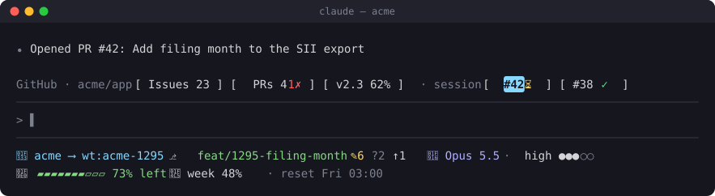

# tokephobia

**A status line for [Claude Code](https://code.claude.com), built for running several sessions in parallel, each in its own worktree.**



- **Know where each session is working.** tokephobia shows the worktree and branch the session actually works in, not the folder it was launched from.
- **Watch the budget.** It shows context left, plan usage and when it resets, and the model with its reasoning effort.

For this session's PRs above the prompt, see [claude-gh](https://github.com/albertomarturelo/claude-gh).

## Quickstart

### Let Claude install it

Paste this into Claude Code:

```text
Install tokephobia: clone https://github.com/albertomarturelo/tokephobia
and follow its INSTALL.md step by step.
```

[INSTALL.md](INSTALL.md) is written for agents. It checks the requirements, installs, verifies the result and tells you what changed.

### Or by hand

```sh
git clone https://github.com/albertomarturelo/tokephobia.git ~/.local/share/tokephobia
node ~/.local/share/tokephobia/bin/tokephobia.mjs install
```

Then start a new Claude Code session. You need **Node.js 24+** and `git`. There is nothing to build and there are no dependencies to install.

## What you see

### Every session in its own worktree


Claude Code only tells a status line which folder a session was **launched** in. When a session runs `git worktree add ../acme-1295` and works there, other status lines keep showing `main`. tokephobia follows the session's own transcript instead, so each session shows where it really is.

| Segment | Meaning |
|---|---|
| `🌳 repo ⟶ wt:name` | Working in a linked worktree. `📁 repo` means the main checkout. |
| `⎇ branch` | Branch of that worktree (short SHA when HEAD is detached). |
| `✖1` `✎6` `?2` | Files with conflicts, with changes, and untracked. |
| `↑1 ↓2` | Commits ahead of and behind upstream. |
| `🤖 Opus 5.5 · high ●●●○○` | Model and reasoning effort (`low` to `max`). `⚡fast` when fast mode is on. |
| `🧠 73% left` | Context left: green above 40%, yellow up to 40%, red up to 20%. |
| `📅 5h 38% · reset in 2h   week 48% · reset Fri 03:00   Fable 41%` | Plan usage used in the 5-hour window, the week, and each model's week (Fable), with when each resets: yellow from 75%, red from 90%. A model's reset is left out when it matches the week's. |

**Where plan usage comes from.** Claude Code only passes the status line the 5-hour and weekly windows, and only once a response has reported them. The per-model weeks are in claude.ai's usage report, the one `/usage` shows. On a claude.ai subscription, tokephobia fetches that report in the background every 3 minutes with Claude Code's own login (read from the macOS Keychain, or `~/.claude/.credentials.json` elsewhere), sends it only to `api.anthropic.com`, and keeps just the percentages and reset times in its cache. macOS may ask once whether `security` can read the `Claude Code-credentials` item: choose **Always Allow**. Set `TOKEPHOBIA_NO_USAGE=1` to turn it off and show only what Claude Code passes.

## How it works

```
Claude Code ──JSON on stdin──▶ bin/tokephobia.mjs ──▶ status line (2 lines)
                                  │  reads the session transcript incrementally
                                  │  runs git in the active worktree
                                  ▼
                          ~/.cache/tokephobia (transcript progress, plan usage)
```

- **Active worktree:** the `git worktree list` entry that holds the last place the session *worked*. That means files it edited or wrote, and `cd`, `git -C` and `git worktree add` targets in commands it ran. Reads, heredoc bodies and quoted text don't count. If there is none, it uses the launch folder.
- **Separate sessions:** each one reads only its own transcript, so parallel sessions never mix.

## Install details

`tokephobia install` sets one thing in `~/.claude/settings.json` (or `$CLAUDE_CONFIG_DIR/settings.json`) and leaves everything else as is:

- **`statusLine`** runs `bin/tokephobia.mjs`. A status line that isn't tokephobia is first backed up to `settings.json.bak-tokephobia-<date>`.
- **Old GitHub plugin:** earlier versions also added their `plugin/` folder to `env.CLAUDE_CODE_PLUGIN_DIRS`. `install` and `uninstall` take that entry out and leave the others; the plugin is now [claude-gh](https://github.com/albertomarturelo/claude-gh).

Other options and commands:

- **Another settings file:** `--settings <path>`, for example a project's `.claude/settings.json`.
- **Running it twice** changes nothing.
- **Update:** `git -C ~/.local/share/tokephobia pull`. No reinstall is needed.
- **Remove:** `node ~/.local/share/tokephobia/bin/tokephobia.mjs uninstall`. It removes only what is tokephobia's.

## Development

```sh
npm install          # dev tools only: typescript, @types/node
npm test             # status line tests (node --test)
npm run typecheck    # tsc --noEmit
```

- **Live testing:** to try a change in real sessions, run `node bin/tokephobia.mjs install` from the checkout you're working in.
- **Cache:** it lives in `~/.cache/tokephobia/`, with each transcript's progress in `sessions/` and the plan usage report in `usage.json`. Override the location with `TOKEPHOBIA_CACHE_DIR`.
- **Raw payloads:** `scripts/capture-statusline.mjs` is a diagnostic status line that saves the raw JSON Claude Code sends to `fixtures/captures/`, which is git-ignored. Use it to see what a new Claude Code version sends.
- **Images:** the pictures in `docs/` are SVG mockups of the real output.

## License

[MIT](LICENSE)
